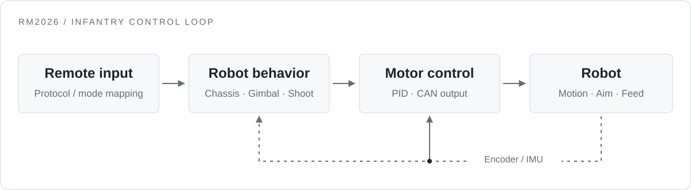

<picture>
  <source media="(prefers-color-scheme: dark)" srcset="./assets/header-dark.svg" />
  
</picture>

**完整实现 RoboMaster 步兵机器人整车电控。** 关注嵌入式控制、整车联调，以及让问题可定位、让实现可验证的工程方法。

<a href="https://github.com/totrytakeoff/RM2026/tree/basic_framework">
  <picture>
    <source media="(prefers-color-scheme: dark)" srcset="./assets/highlights-dark.svg" />
    
  </picture>
</a>

<picture>
  <source media="(prefers-color-scheme: dark)" srcset="./assets/stack-dark.svg" />
  
</picture>

## 01 / RM2026：整车电控

在 **YZ Control** 战队协作项目中，完成步兵机器人的整车电控实现与联调。基于 **STM32F407**，把遥控输入、底盘运动、云台控制、发射机构与传感反馈连成完整的控制链路。

[赛季控制基线 ↗](https://github.com/totrytakeoff/RM2026/tree/basic_framework)　[当前框架分支 ↗](https://github.com/totrytakeoff/RM2026/tree/refactor/infantry-freertos)　[整车应用源码 ↗](https://github.com/totrytakeoff/RM2026/tree/refactor/infantry-freertos/applications/infantry)

<picture>
  <source media="(prefers-color-scheme: dark)" srcset="./assets/control-loop-dark.svg" />
  
</picture>

| 模块 | 技术要点 | 当前实现 |
| :--- | :--- | :--- |
| **底盘** | 运动学解算、坐标变换、云台跟随、小陀螺与轮速分配 | [chassis/](https://github.com/totrytakeoff/RM2026/tree/refactor/infantry-freertos/applications/infantry/chassis) |
| **云台** | Yaw / Pitch 控制、IMU 反馈、角度与速度状态切换、软硬限位 | [gimbal/](https://github.com/totrytakeoff/RM2026/tree/refactor/infantry-freertos/applications/infantry/gimbal) |
| **发射** | 摩擦轮与拨弹协同、单发 / 连发、扳机边沿与状态管理 | [shoot/](https://github.com/totrytakeoff/RM2026/tree/refactor/infantry-freertos/applications/infantry/shoot) |
| **输入与通信** | 遥控状态归一化、模式映射、CAN / UART 收发与掉线处理 | [command/](https://github.com/totrytakeoff/RM2026/tree/refactor/infantry-freertos/applications/infantry/command) |

<b>深入看：FreeRTOS 运行时与工程验证</b>

当前框架分支进一步梳理整车控制的任务边界与数据所有权：

- **任务职责**：姿态解算、整车控制、电机执行、健康监测分工；控制任务发布完整命令，电机任务独占 PID 状态与 CAN 输出。
- **状态一致性**：使用姿态快照和电机命令邮箱，处理跨任务共享状态；命令租约限制过期输出。
- **故障处理**：输入有效性、设备在线状态、任务健康和独立看门狗共同参与输出管理。
- **验证入口**：主机逻辑测试覆盖输入适配、运动学、云台限位、扳机状态与 PID reset；配套板级回归和链接审计。

[控制所有权设计](https://github.com/totrytakeoff/RM2026/blob/refactor/infantry-freertos/docs/migration/control_ownership_milestone.md) · [任务实现](https://github.com/totrytakeoff/RM2026/blob/refactor/infantry-freertos/firmware/infantry_f407/freertos/infantry_tasks.c) · [主机测试](https://github.com/totrytakeoff/RM2026/tree/refactor/infantry-freertos/tests/host)

这里展示的是后续框架重构分支；该分支的实板回归状态以仓库验收记录为准。

## 02 / 具体问题，具体定位

**[云台控制与调试记录](https://github.com/czself/gimbal)** · STM32F407 / BMI088 / GM6020 / VOFA+

- **电机反馈与命令映射**：沿 CAN 报文 ID、物理电机 ID、反馈数组和输出索引逐层追踪，定位通信正常但电机不动作的问题。
- **姿态与控制器状态**：记录陀螺仪零偏、Yaw 漂移、积分累积和稳态误差之间的关联。
- **可观测性**：结合总线错误计数、收发计数和 VOFA+ 遥测，保留“现象 → 原因 → 修复”的调试过程。

[查看调试日志 ↗](https://github.com/czself/gimbal/blob/main/DEBUG_LOG.md)

## 03 / 更多实践

| 项目 | 技术延伸 |
| :--- | :--- |
| **[STM32 寄存器 / HAL 双轨教程](https://github.com/czself/stm_regis_hal)** | 外设、通信与 FreeRTOS，源码配套中文讲解。 |
| **[ROS 智慧社区机器人](https://github.com/czself/ros)** | Gazebo 仿真中的建图、导航、十点巡检与视觉识别。 |
| **[YZ Control 战队官网](https://github.com/czself/robot_web_team)** | Next.js / React / TypeScript，战队展示与队员门户。 |
| **[TinyVim 终端 IDE](https://github.com/czself/TinyVim-IDE)** | Rust 开发工具，集成编译运行、文件浏览与 AI 编辑预览。 |

---

[主项目 RM2026](https://github.com/totrytakeoff/RM2026/tree/basic_framework) · [云台调试记录](https://github.com/czself/gimbal/blob/main/DEBUG_LOG.md) · [全部仓库](https://github.com/czself?tab=repositories)
