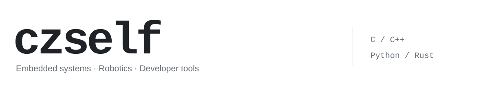

<picture>
  <source media="(prefers-color-scheme: dark)" srcset="./assets/header-dark.svg" />
  
</picture>

主要项目是 **YZ Control · RM2026**，围绕 **RoboMaster 机器人电控**，记录嵌入式开发、系统联调与工程验证的实践。

`C / C++`　`STM32`　`FreeRTOS`　`CAN / UART`　`机器人控制`

## 主项目 · RM2026

### [YZ Control / RM2026 — RoboMaster 机器人电控](https://github.com/totrytakeoff/RM2026/tree/refactor/infantry-freertos)

YZ Control 战队协作工程，基于 **STM32F407**，面向 RoboMaster 赛季的机器人电控开发。当前框架分支以单板步兵固件为主目标，将应用行为、设备组件、板级适配与实时运行时分层组织。

- **固件架构**：机器人应用与硬件平台分离，正式 FreeRTOS 固件与裸机对照固件复用应用逻辑。
- **实时运行时**：静态任务、输入安全、设备健康、命令租约与独立看门狗，明确控制与执行边界。
- **工程验证**：CMake 构建、主机逻辑测试、板级回归固件及链接审计；重构后的实板验收仍在推进。

[当前框架分支 →](https://github.com/totrytakeoff/RM2026/tree/refactor/infantry-freertos) · [赛季控制基线 →](https://github.com/totrytakeoff/RM2026/tree/basic_framework) · [战队官网工程 →](https://github.com/czself/robot_web_team)

## 其他实践

| 项目 | 做什么 | 主要技术 |
| :--- | :--- | :--- |
| **[STM32 全栈修炼手册](https://github.com/czself/stm_regis_hal)** | 寄存器与 HAL 双轨对照，覆盖外设、通信与 FreeRTOS；代码配套中文讲解。 | `C` `STM32` `PlatformIO` |
| **[智慧社区机器人](https://github.com/czself/ros)** | 在 Gazebo 仿真中串联建图、导航、十点巡检与视觉识别，保留任务日志和验证记录。 | `Python` `ROS Noetic` `Gazebo` |
| **[TinyVim](https://github.com/czself/TinyVim-IDE)** | 面向 C/C++ 与 Python 的轻量终端 IDE，集成编译运行、文件浏览与 AI 编辑预览。 | `Rust` `TUI` `CLI` |

---

[浏览全部仓库 →](https://github.com/czself?tab=repositories)
